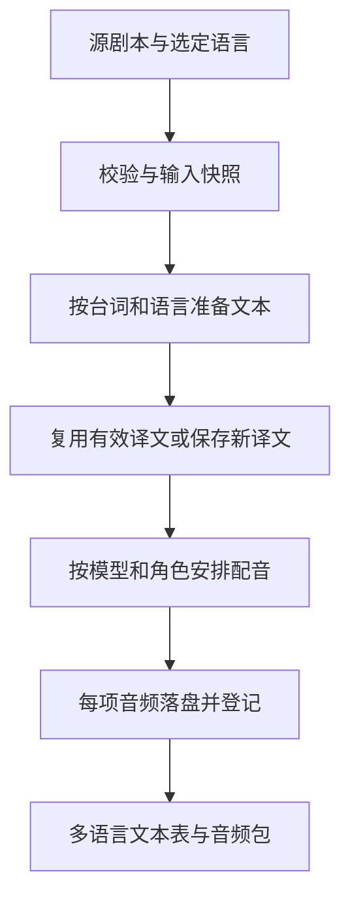

# 模型复用与游戏多语言制作方案

日期：2026-09-12。状态：第一至第四阶段已实现，并加入麦克风录制和本地 Whisper 转写。下文保留设计依据；具体可导入数据格式以代码 schema 和 `woosh_studio/agent_workflow/woosh-studio/assets/script.multilingual.example.json` 为准。

实现入口：

- `model_runtime.py` / `worker_protocol.py`：常驻进程、请求隔离、统一租约、30 秒握手/600 秒加载超时、空闲释放与取消回收。
- `speech.py` / `localization.py` / `storage.py`：逐台词逐语言保存、输入指纹、锁定译文、提交日志恢复、部分成功与重试。
- `ReferenceAudioTools.tsx` / `asr_worker.py` / `transcription.py`：用户发起录音、音量显示、WAV试听和导入、Whisper识别、并发编辑保护。
- `LocalizedLineEditor.tsx` / `SpeechView.tsx`：语言多选、显示/朗读文本、语言音色覆盖与审核。
- `exports.py`：CSV/JSON/音频的稳定ID对应，导出前完整性检查；旧项目迁移到 V3 时保留原文件备份。

边界：模型仍需要在首次使用或应用重启后加载；重型模型切换会按单模型策略释放旧实例。音效目前保留进程内执行，在变体之间响应取消；音乐低显存模式仍会进行 GPU 换入换出。术语表用于提示和人工核对，暂不提供术语约束解码；第五阶段的多模型同时驻留、引擎专用适配器和口型/时间对齐保留为后续扩展。Whisper 权重为可选安装项，当前测试未证明实机识别准确率、模型音质或显卡性能。

目标：连续制作时复用已加载模型；一份剧本选择多个输出语言，分别生成可编辑文本与角色配音，并按稳定台词 ID 导出给游戏。

## 1. 现状与可复核的依据

| 模块 | 当前行为 | 需要改变的地方 |
| --- | --- | --- |
| 配音 | `speech.py` 在每句台词调用 `_run_worker`；每次 `Popen` 新进程。`speech_worker.py` 只读一次输入，每次 `generate` 都调用 `Qwen3TTSModel.from_pretrained` | 跨句、跨任务复用进程和模型实例 |
| 音乐 | `music.py` 每个变体启动工作进程，`music_worker.py` 每次构造 HeartMuLa pipeline | 复用 pipeline，并调整“生成后分轨”的批处理顺序 |
| 分轨 | 每次创建 Demucs `Separator` | 复用分离器 |
| 音效 | `InferenceService._load_model` 已按模型 ID、设备缓存；界面在查询缓存前总是报告“加载模型” | 保留缓存，报告实际加载状态；补齐模型路径、版本失效条件 |
| 翻译 | 中英翻译和多语翻译已经缓存 CPU INT8 实例 | 复用现有实现；补齐路径/模型更新的缓存失效 |
| GPU 调度 | 音效、音乐共用 `InferenceCoordinator`；配音另建 `SpeechCoordinator` | 所有 GPU 推理共用调度入口 |
| 剧本 | 每句只有一个 `language`、一个 `translation`、一个 `asset_id` | 同一台词保存多份语言结果 |
| 游戏导出 | 主要导出音频与素材 manifest；Wwise 当前按音乐/SFX分类，FMOD输出素材清单 | 增加台词文本表、语言目录、台词与音频对应关系；引擎适配另行验证 |

复核文件：`woosh_studio/speech.py`、`speech_worker.py`、`music.py`、`music_worker.py`、`inference.py`、`dialogue.py`、`main.py`、`schemas.py`、`exports.py`，以及 `frontend/src/views/SpeechView.tsx`。

本地复现：在临时目录、测试音频模式下，对同一个 `SpeechService` 连续调用 `_run_worker` 两次，得到 `consecutive_calls=2`、`worker_processes_started=2`、`distinct_worker_processes=2`。此结果验证进程生命周期；没有测量真实模型加载耗时、显存或音质。

本机安装的 Qwen TTS 实现提供 `create_voice_clone_prompt` 和可重复传入的 `voice_clone_prompt`，因此除了模型本身，也可以缓存角色参考音频的编码。安装的 HeartMuLa pipeline 在 `lazy_load=True` 时会主动卸载子模型：仅保留进程不能消除该模式内部的权重重载，需要单独处理。

## 2. 模型生命周期：首次按需加载，连续任务复用

新增 `ModelRuntimeManager`，生命周期跟随后端应用。先让现有音效缓存接入统一调度；语音、音乐和分轨通过受管理的常驻子进程提供服务。子进程使用持续读取的 UTF-8 JSON Lines 协议，标准输出仅输出协议事件，第三方日志转到标准错误。

工作进程不随项目切换或一次任务结束而退出。每个已加载实例的标识包括：模型家族、模型绝对路径与权重版本/清单摘要、设备、精度/量化、加载模式。语言、台词内容和角色名称不属于加载标识；同一模型换语言不应触发重新加载。

所有调用从管理器获取租约。默认单 GPU 同时只有一个重型推理任务执行，CPU 翻译可在有资源预算时提前准备。加载中、运行中、释放中的实例不能被其他请求重复加载或卸载。

建议的默认策略：

- 模型第一次使用时加载，任务完成后保留；提供显式“预加载”和“释放模型”操作。
- 第一版默认只保留当前使用的一个重型 GPU 模型。切到另一个重型模型时安全释放旧模型，接下来相同模型的连续任务继续复用。
- 初始空闲保留时间建议为 10 分钟，并提供“关闭应用前保留”和“任务后释放”的设置。10 分钟是产品初值，需根据实机体验调整。
- 翻译优先在 CPU 保留。CPU 总内存也纳入预算，不能无限缓存重型模型。
- 多模型同时驻留、CPU 换出保留权重作为后续策略；必须依据实测峰值、可用内存、推理临时空间和运行中的游戏/编辑器占用决定，不能只按显卡总容量硬编码。
- 音乐低显存模式保留子模型换入换出的必要行为；界面明确区分“工作进程已复用”与“正在换入权重”，不承诺低显存下完全消除重载。

### 工作进程协议与失败恢复

命令建议：`load`、`generate`、`separate`、`unload`、`ping`、`shutdown`。每条消息携带 `request_id`，任务相关事件携带 `job_id`、`item_id`；结果只能由匹配请求接收。管理器集中处理进程锁、输出读取、超时和关闭，替换语音/音乐里重复的进程管理代码。

- 进程启动握手和模型加载分别设定超时。推理时不能因暂时没有进度日志就判定失败；无响应的判定需结合阶段、合理时限与进程存活状态。
- 排队期间支持立即取消。推理中的取消优先使用引擎提供的中断能力；不支持安全中断时，终止对应工作进程，下一次任务重新加载。
- 取消或超时后不能把旧请求的迟到结果分配给下一任务。仅终止本应用管理的进程并回收管道/读取线程。
- 加载失败不登记为 ready。GPU OOM 后清理失效实例，保留已完成项；只在有明确降级策略时有限重试，并记录实际精度/设备。固定精度请求不得静默降级。
- 修改设备、模型目录、替换/删除权重时通过管理器统一失效缓存；有租约时等待或报告忙碌，不在推理中删除模型。
- 应用关闭时停止接收任务、取消/收尾当前执行、回收子进程。重启后模型仍需重新加载，但已完成的素材可继续使用。

### 角色与批次复用

角色克隆 prompt 按“模型版本 + 参考音频内容摘要 + 参考文本 + 编码参数”缓存。修改参考录音后必须重新编码；使用有界缓存，随模型释放一起回收，先不将模型相关张量持久化到磁盘。

批次优先按模型分组，例如所有 CustomVoice 台词完成后再处理 Base 克隆台词；同一角色的参考编码在多个语言中复用。小批量合成可以后续增加，第一版先保证逐项生成时的模型复用和取消可靠性。

音乐多个变体带分轨时，优先先生成全部 mix，再统一执行 Demucs，避免每个变体反复切换两类模型。用户可选择优先拿到第一份完整结果；执行顺序不会改变素材所属关系。

界面状态：未加载 → 等待设备 → 正在加载 → 已就绪/复用中 → 推理中 → 已释放/失败。记录 `load_count`、冷加载时间、生成时间和缓存命中；“模型已安装”与“已加载”分别显示。

## 3. 剧本数据：一条台词，多语言版本

游戏侧始终使用同一条台词的稳定 ID。台词排序、角色显示名称、语言切换、重新配音都不改变该 ID。可额外提供面向策划的稳定 key（例如 `chapter01.guard.greeting`）；key 冲突要在导入/保存时处理，不能按行号重新生成。

建议新增 `ProjectManifestV3` 和 `woosh.script` 模板 version 2。下表是概念结构，具体字段由实现时的严格 schema 固定：

| 层级 | 核心数据 |
| --- | --- |
| 剧本 | 源语言、目标语言列表、默认预览语言、术语表、角色、台词 |
| 台词 | 稳定 ID、可选 key、角色 ID、场景/上下文、源文本及修订、启用状态 |
| 每种语言版本 | 显示文本、实际朗读文本、翻译来源、源文本修订、审核/锁定状态、当前音频资产 ID、历史结果 |
| 角色 | 默认音色配置，以及每个语言可选的覆盖配置 |
| 任务项 | 台词 ID、语言、输入指纹、状态、尝试次数、输出资产、错误信息 |
| 音频资产 | 台词 ID、语言、文本/音色快照、引擎和模型版本、采样率、时长、生成参数 |

语言使用稳定 locale 标识，项目界面语言独立保存。第一版可提供中文、英语、日语、韩语及现有配置中的其他语言；每项是否可翻译/可配音由实际引擎能力校验。locale 到引擎语言参数通过适配表转换，例如 `ja` → `Japanese`。简繁体、地区口音需要单独标明支持程度，不把引擎的通用 Chinese/English 能力当成地区承诺。

源语言在项目里明确选择，新导入内容可以自动检测后由用户修改；`Auto` 不允许作为最终导出语言或目标语言 key。纯汉字短句和拉丁语种的自动识别存在歧义，不能依赖现有正则推断正式游戏资产的语言。

结构示例（设计示意，不能直接导入当前 version 1 解析器）：

```json
{
  "id": "dialogue-guard-001",
  "key": "chapter01.guard.greeting",
  "character_id": "guard",
  "source": {"locale": "zh-CN", "text": "欢迎来到星港。", "revision": 1},
  "localizations": {
    "zh-CN": {"text": "欢迎来到星港。", "spoken_text": "欢迎来到星港。", "source_revision": 1, "asset_id": null},
    "en": {"text": "Welcome to Starport.", "spoken_text": "Welcome to Starport.", "source_revision": 1, "asset_id": null},
    "ja": {"text": "スターポートへようこそ。", "spoken_text": "スターポートへようこそ。", "source_revision": 1, "asset_id": null}
  }
}
```

各语言译文只是示例，不代表已经经过游戏语境审核。

## 4. 工作台操作与游戏本地化

顶部提供“输出语言”多选，记住项目选择。比如 100 句启用台词，勾选中/英/日后，显示“100 句 × 3 语言 = 300 份配音”，并列出可复用、新增、过期、失败的数量。

每句保留源文，下面按语言标签切换查看译文、编辑配音文本、试听和历史版本；提供“全部语言”“只看待处理”和按角色/场景筛选。默认避免把所有语言的长文本同时铺满屏幕。

提供三种动作：

1. 准备多语言文本：翻译缺失/过期项，展示结果并允许人工编辑或锁定。
2. 一键生成文本与配音：先准备文本，再生成各语言音频，默认跳过指纹匹配且文件完好的结果。
3. 只重做选中台词或语言：保留其他语言的有效成果；强制重做产生新版本。

“多语言同时输出”指一次提交产生所有选定语言的结果。单 GPU 默认排队执行，进度中显示当前语言/角色、完成数和失败数。

角色默认跨语言复用同一音色，也支持各语言覆盖。例如主角中文使用参考录音 A、日语使用参考录音 B。覆盖配置同时包括参考文本、引擎/模型、发音和表演指导；改变日语配置只使日语音频过期。跨语言声线一致性和各语种发音质量需要试听验收。

游戏文本需要保留：

- 人名、地名、技能名和物品名的术语表，以及场景、说话对象、情绪等上下文。
- 显示文本与朗读文本的区别：字幕保留富文本/变量标记，朗读使用审定后的读法。包含运行时变量的台词必须明确替换/分段策略，不能把占位符直接读入正式音频。
- 分支台词独立导出，不根据编辑器列表顺序推定一条线性的游戏时间轴。
- 源文本变化后保留人工译文并标记“源文已变更”；锁定译文不得被自动翻译覆盖。审核状态和音频是否过期分别保存。
- 现有本地翻译器逐句工作，没有术语控制和剧情上下文接口。第一版提供术语提示、占位符一致性检查、人工编辑与锁定；要自动保证术语或使用上下文，需要明确支持这些能力的翻译适配器，不能仅追加一个“术语表”字段就声称已实现。

## 5. 任务拆分、增量生成与中断恢复



父任务表示一次用户提交，工作项标识为 `(line_id, locale, input_fingerprint)`。工作项存入数据库，不能仅存在内存数组。指纹使用规范化后的输入，包括源文修订、最终朗读文本、语种、有效音色配置、参考文件内容摘要、模型版本和采样参数；翻译与音频采用各自的指纹。修改只影响显示的字幕且未改变朗读文本时，允许复用对应音频。

默认跳过已完成、指纹匹配、文件存在且校验有效的结果。用户“再生成一个版本”时显式绕过复用。重复提交的同一工作项只允许一个执行租约；缓存仅在项目和明确的模型版本范围内使用。

每项先写临时文件、验证可读取与时长，再原子改名并登记项目/数据库。两类存储并非同一事务，因此需要提交日志和启动对账：未登记文件可恢复为历史资产，缺失文件标记待重做，禁止错误地显示完成。

每句每语言完成即保存，避免直到全批完成才登记。生成期间用户修改台词、译文、音色或删除台词时，结果按开始时的快照保存；只有当前指纹仍一致才挂到“当前版本”。旧结果进入历史，不覆盖用户编辑。

`continue_on_error` 目前已在请求 schema 中存在，但语音循环尚未落实。实现后：允许继续时单项失败不影响其他项；停止时保留所有已完成项。父任务明确报告全部成功、部分成功、失败、取消或中断，并提供失败项重试。暂停在安全边界生效，不宣称已中断无法暂停的底层推理。

重启后的运行项标记为 interrupted，通过用户恢复/重试继续未完成项。模型进程无法跨应用重启常驻，恢复时首次加载是正常行为。

## 6. 游戏交付格式

第一阶段采用引擎中立格式；游戏读取 `line_id/key + locale` 即可定位文本和声音。输出只使用审核/导出策略选定的当前版本，历史试音不会混入正式包。

```text
Exports/<package>/
  manifest.json
  dialogue.csv
  text/
    zh-CN.json
    en.json
    ja.json
  audio/
    zh-CN/dialogue-guard-001.wav
    en/dialogue-guard-001.wav
    ja/dialogue-guard-001.wav
```

`dialogue.csv` 至少包括 `line_id,key,scene_id,character_id,locale,text,spoken_text,audio_path,duration_ms,status,source_revision`；文本、路径和完整性状态严格对应同一版本。CSV 正确转义逗号、引号和换行，JSON使用 UTF-8。文件名由经过验证的稳定 ID 构造，阻止目录穿越与规范化后的同名覆盖。

- 支持先导出纯文本：缺少音频的行保留文本，并明确空音频状态。
- 完整语音包模式在导出前报告缺失/失败/过期语言项，不把旧音频冒充新译文。源语言回退仅在项目显式配置时输出到 manifest。
- 配音保留实际采样率与通道数；如导出预设要求统一采样率，执行真实重采样，而非只改 manifest。
- SRT/VTT 可在拥有明确顺序和时间信息的过场场景中导出；分支对白先交付每条音频与局部时长。第一版不声称有字级对齐或口型数据。
- Unity、Unreal、Wwise、FMOD 采用独立适配层。待明确游戏引擎及版本后验证其目标导入格式。现有 Wwise “Sound SFX”表不能直接视为多语言对白导入器；现有 FMOD清单也不代表已经生成 bank。

## 7. 迁移与实施顺序

迁移前保存旧 manifest 副本，V1 按既有逻辑升到 V2，再显式迁移到 V3。把原 `language + translation + asset_id` 搬到对应语言版本；原文与旧音频必须保留。没有明确语言/修订依据的旧结果标记为待核对，不凭默认值认定新语言已有配音。

新解析器继续读旧 version 1 模板；新多语言模板使用 version 2，跨项目导入清除所有语言版本的资产引用。角色合并、追加剧本、ID重映射、资源引用重绑定、撤销都必须覆盖语言版本。V2旧客户端不能读取新增字段，因此不能悄悄把扩展写回旧 schema 版本。

| 顺序 | 交付内容 | 主要代码位置 |
| --- | --- | --- |
| 1 | 常驻进程管理、统一GPU调度、真实加载状态、取消/关闭清理 | 新 runtime manager；`speech.py`、`speech_worker.py`、`music.py`、`music_worker.py`、`inference.py`、`main.py` |
| 2 | V3多语言数据、V1/V2迁移、模型语言能力映射 | `schemas.py`、`projects.py`、`dialogue.py`、`workbench.py`、前端类型和导入合并 |
| 3 | 语言多选、逐语言译文/音频、任务项持久化、增量/失败重试 | `SpeechView.tsx`、`api.ts`、`speech.py`、`jobs.py`、`storage.py` |
| 4 | 多语言文本/音频导出、完整性检查和游戏交付样例 | `exports.py`、导出界面、agent工作流模板及文档 |
| 5 | 按真实生产需求加入术语约束翻译、批量推理、更多模型驻留和引擎适配 | 各引擎适配器和独立导出器 |

前四步形成可用闭环。第一步优先解决当前每句重新加载的问题，后续多语言不会把冷加载次数乘以语言数量。第五步按实际设备与游戏需求扩展。

## 8. 验收标准

1. 相同设备和加载配置、常驻有效期内，同一模型连续两次任务以及多句台词只调用一次真实加载函数；独立进程PID复用。修改精度/路径/权重版本时重新加载。
2. 同一 Qwen模型从中文切英语再切日语不重新加载；修改参考录音仅使对应角色prompt重新编码。
3. 同时提交音效、音乐、配音时默认只有一个GPU推理租约；取消排队项、取消运行项、任务异常和退出应用后没有遗留受管进程或忙碌锁。
4. 模拟引擎验证请求ID隔离、进程异常重启、缓存失效和批次分组；实机单独测量冷/热任务耗时与显存峰值。模拟结果不能替代真实模型性能验收。
5. 2句 × 中英日3语言得到6份独立文本/音频对应结果；只修改其中一句日语朗读文本，仅该项过期。第二次普通生成正确复用其他项。
6. 运行中修改剧本或删除角色不会被完成回调覆盖；中途失败、取消、应用重启都能找回已完成项，只重试所需项。
7. 旧项目和旧模板能迁移；跨项目导入不会把任何语言旧资产ID带入；ID碰撞、撤销、音色更新和资源重绑定均保持对应关系。
8. 游戏样例按稳定ID和语言读取导出文本/音频；校验Unicode、标点、多行CSV、缺失文件、重复ID和过期译文；语言回退按显式项目策略执行。

待真实项目落地时确定：游戏引擎及版本、首发语言/地区、开发机GPU与内存预算、角色是跨语言共用声线还是分语言配置、是否有过场时间轴或口型系统。这些不阻碍前四步的通用基础设计。

## 实现验收记录（2026-09-12）

- 后端回归：完整套件 90 passed / 1 skipped；另新增 Whisper 固定版本安装回归 1 passed，共 91 项已通过。跳过项需要真实 HeartMuLa CUDA 模型目录。
- 前端：37 项测试通过；包含麦克风权限拒绝、迟到的授权释放、识别结果不覆盖人工编辑，以及多语言/单语言任务提交。
- 浏览器：2 项 Edge 端到端测试通过。覆盖录制→试听→保存→本地识别→三语配音→日语单独重做→游戏包导出，以及切换页面释放麦克风。
- 前端生产构建与本次改动的 Python lint 通过。
- 自动化使用浏览器测试麦克风和合成音频；Qwen适配器另使用可观测加载/编码次数的模型替身验证缓存。没有将这些结果当作真实模型速度、语种准确率或声线一致性的测量。

源码验收阶段未构建 MSI；后续 0.2.1 的真实模型验证、打包和安装结果见下节。


## 0.2.1 真实模型与安装验收（2026-09-12）

- 已安装官方 Whisper large-v3-turbo，固定权重版本 41f01f3fe87f28c78e2fbf8b568835947dd65ed9；权重文件 1,617,824,864 字节，已按官方 LFS SHA-256 校验。模型目录 E:/AIModels/WooshStudio/Whisper-large-v3-turbo。
- 在 RTX 4060 Ti 上执行真实 Whisper 推理，使用 Windows 本地语音合成产生的中英文控制样本，没有启动物理麦克风。英文转写与原文一致，中文出现“星港/新港”的同音专名差异，其余内容一致。两次请求只加载一次模型。
- 使用真实 Qwen3-TTS Base 克隆参考声线，完成中文和英语配音、资产登记及多语言游戏包导出；两种语言复用同一个模型实例。
- 从离线 runtime ZIP 解压至新目录，在全新虚拟环境中以 uv --offline 安装 156 个依赖，Torch 2.8.0+cu128、Transformers 4.57.3、Qwen、HeartMuLa 和 Demucs 可导入。
- 0.2.1 MSI 已构建、解包检查并成功升级安装到 E:/Dev/Woosh Studio；安装后的应用已启动，Whisper 状态为已安装。
- 离线包：.artifacts/installers/Woosh-Studio-0.2.1-Whisper-offline-x64.zip，11,118,198,302 字节。包含应用（内置多语翻译）、Whisper 和离线运行环境，其他生成模型沿用共享模型库。
- 真实模型报告位于 .artifacts/whisper-release-verification/real-whisper-report.json 与 real-dubbing-report.json；安装日志 .artifacts/whisper-release-install.log。
